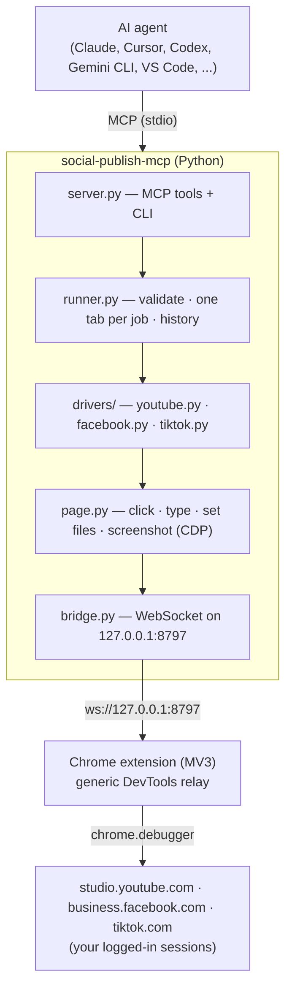

<div align="center">

# Social Publish MCP

**Let any AI agent upload, schedule and publish your videos on YouTube, Facebook and TikTok —
through the Chrome you are already logged into. No API keys. No developer apps. No app review.**

[](https://github.com/h4775346/social-publish-mcp/actions/workflows/ci.yml)
[](LICENSE)


</div>

---

**Social Publish MCP** is a [Model Context Protocol](https://modelcontextprotocol.io) server plus a small companion
Chrome extension. Ask Claude, Cursor, Codex, Gemini CLI, VS Code Copilot or any other MCP agent:

> *"Schedule `short_07.mp4` on YouTube, TikTok and Facebook tomorrow at 17:00 Cairo time, with these captions."*

and it opens YouTube Studio, TikTok Studio and Meta Business Suite in your own Chrome, uploads the file, fills in the
title, description, hashtags, playlists and schedule exactly like you would, and reports back the scheduled time and
the video link.

## ⚡ Quick install

**Option A: let your AI agent install it.** Paste this into Claude Code, Cursor, Codex, Gemini CLI, Windsurf, VS Code
or any agent that can run commands:

```text
Install Social Publish MCP for me by following https://github.com/h4775346/social-publish-mcp/blob/main/docs/AGENT_INSTALL.md
```

**Option B: one command.**

```powershell
# Windows (PowerShell)
irm https://raw.githubusercontent.com/h4775346/social-publish-mcp/main/install.ps1 | iex
```
```bash
# macOS / Linux
curl -LsSf https://raw.githubusercontent.com/h4775346/social-publish-mcp/main/install.sh | sh
```

Either way, everything is set up for you:
- **uv:** installed if missing.
- **Server:** installed as the `social-publish-mcp` command.
- **Chrome extension:** copied to `~/.social-publish-mcp/extension`.
- **Agent skill:** installed for Claude Code.
- **MCP registration:** in every AI client found on your computer (Claude Code, Claude Desktop, Cursor, Windsurf,
  VS Code, Gemini CLI, Codex).

**The only thing left for you** (Chrome allows extensions only by hand). The installer has already opened the page
and the folder:

1. In `chrome://extensions`, turn on **Developer mode**.
2. Click **Load unpacked**, choose `~/.social-publish-mcp/extension`.
3. Restart your AI client and ask it: *"check my social accounts"*.

## Contents

- [Quick install](#-quick-install)
- [Features](#features)
- [Why not the official APIs?](#why-not-the-official-apis)
- [How it works](#how-it-works)
- [Requirements](#requirements)
- [Installation](#installation)
  - [1. Install the server](#1-install-the-server)
  - [2. Load the Chrome extension](#2-load-the-chrome-extension)
  - [3. Log in to the platforms](#3-log-in-to-the-platforms)
  - [4. Verify](#4-verify)
- [Connect your AI agent](#connect-your-ai-agent)
- [Usage](#usage)
  - [Talking to your agent](#talking-to-your-agent)
  - [Tools reference](#tools-reference)
  - [Platform options](#platform-options)
  - [Command line](#command-line)
  - [Batch files](#batch-files)
- [Scheduling rules and validation](#scheduling-rules-and-validation)
- [Configuration](#configuration)
- [Troubleshooting](#troubleshooting)
- [FAQ](#faq)
- [Security and privacy](#security-and-privacy)
- [Terms of service and fair use](#terms-of-service-and-fair-use)
- [Development](#development)
- [License](#license)

## Features

| | |
|---|---|
| **Three platforms** | YouTube Studio (Shorts and regular videos), Facebook Page reels (Meta Business Suite), TikTok Studio |
| **Publish or schedule** | Publish now, or schedule in the platform's own scheduler at an exact time with a time zone |
| **Cross-post in one call** | One video to all three platforms in parallel, each with its own caption |
| **Batches** | A week of posts from one JSON file; everything is validated before anything is touched |
| **Full quality, any size** | Files are attached by path over the Chrome DevTools Protocol: no file dialog, no upload size cap |
| **Real typing** | Captions are typed as trusted input: Arabic/RTL, emoji, hashtags and line breaks come out exactly right |
| **Dry runs** | Fill in everything and stop before the final button, to check a new template safely |
| **Verified results** | Each result carries the confirmed schedule (as the platform displays it) and, where available, the link |
| **Failure evidence** | Every failure returns the failed step, a screenshot and (Facebook) a DOM summary |
| **Works with every MCP agent** | Claude Code, Claude Desktop, Cursor, VS Code, Windsurf, Codex, Gemini CLI, Cline, Zed, OpenCode, … |
| **Shared by several agents** | Several agents (and the CLI) can use it at the same time through one bridge |

## Why not the official APIs?

The official APIs are the right choice for large publishers. For one creator or a small team they mean an OAuth
app per platform, review processes and hard restrictions:

- **YouTube Data API**: uploads from unaudited API projects are locked to *private*.
- **TikTok Content Posting API**: requires an audited developer app; unaudited apps can only post privately.
- **Facebook Graph API**: needs a Meta app, permissions review and long-lived page tokens.

You already have all three sites open in Chrome. Social Publish MCP lets an agent do exactly what you would do there,
at human pace, on your own accounts.

## How it works



- The **extension contains no site logic**. It opens a tab in a dedicated *Social Publish* window, attaches the
  Chrome debugger to that tab only, and relays DevTools commands.
- All site flows live in the **Python drivers**, so a site redesign is fixed with a server update; the extension
  does not need to change.
- Each job gets **its own tab**, which is closed when the job ends.

## Requirements

| | |
|---|---|
| Python | 3.10 – 3.13 |
| [uv](https://docs.astral.sh/uv/) | recommended installer (pip/pipx also work) |
| Browser | Google Chrome 116+ (or Edge/Brave/another Chromium browser that loads unpacked MV3 extensions) |
| OS | Windows, macOS, Linux |
| Accounts | logged in to YouTube Studio / Meta Business Suite / TikTok Studio in that browser profile |
| UI language | **English** platform UI (the drivers read English labels such as "Schedule", "Next") |

## Installation

### 1. Install the server

Install **uv** if you do not have it:

```bash
# macOS / Linux
curl -LsSf https://astral.sh/uv/install.sh | sh
```
```powershell
# Windows (PowerShell)
powershell -ExecutionPolicy ByPass -c "irm https://astral.sh/uv/install.ps1 | iex"
```

Then install Social Publish MCP as a command-line tool, straight from GitHub:

```bash
uv tool install git+https://github.com/h4775346/social-publish-mcp
social-publish-mcp --version
```

<details>
<summary>Other ways to install</summary>

```bash
# run without installing (always the latest commit)
uvx --from git+https://github.com/h4775346/social-publish-mcp social-publish-mcp --version

# from a local clone (needed anyway for the extension folder)
git clone https://github.com/h4775346/social-publish-mcp.git
cd social-publish-mcp
uv tool install .

# with pipx or pip
pipx install git+https://github.com/h4775346/social-publish-mcp
pip install git+https://github.com/h4775346/social-publish-mcp

# upgrade later
uv tool upgrade social-publish-mcp
```
</details>

Then let it set up the extension folder, the skill and your AI clients in one go:

```bash
social-publish-mcp setup                      # every client found on this computer
social-publish-mcp setup --client cursor      # or only the ones you name (repeatable)
```

| `setup` option | Effect |
|---|---|
| `--client NAME` | configure only these clients: `claude-code`, `claude-desktop`, `cursor`, `windsurf`, `vscode`, `gemini`, `codex` |
| `--no-skill` | do not install the Claude Code skill |
| `--no-extension` | do not copy the extension folder |
| `--no-open` | do not open `chrome://extensions` and the extension folder |

Config files are merged (your other MCP servers are kept) and backed up as `*.bak` first.

### 2. Load the Chrome extension

1. `social-publish-mcp setup` copies the extension to **`~/.social-publish-mcp/extension`**
   (Windows: `C:\Users\<you>\.social-publish-mcp\extension`). You can also use the `extension/` folder of a clone.
2. Open **`chrome://extensions`** (Edge: `edge://extensions`, Brave: `brave://extensions`).
3. Turn on **Developer mode** (top right).
4. Click **Load unpacked** and select the **`extension`** folder of the repository.
5. Pin **Social Publish MCP** to the toolbar. Its badge shows:
   - **off** (red): no server running. This is normal until an agent or the CLI starts the server.
   - **on** (green): connected and idle.
   - a **number** (amber): jobs running.

The first extension that connects is trusted and pinned (its id is saved in `~/.social-publish-mcp/extensions.json`);
connections from any other extension or from web pages are refused.

> When a job runs, Chrome shows *"Social Publish MCP started debugging this browser"*. This is how the extension
> clicks and types. **Do not press Cancel** while a job is running.

### 3. Log in to the platforms

In the same Chrome profile, log in as you normally do:

| Platform | Page that must work | Notes |
|---|---|---|
| YouTube | <https://studio.youtube.com> | If your Google account owns several channels, pass `channel_id` (it starts with `UC`). |
| Facebook | <https://business.facebook.com> | Posts go to the Page selected in Business Suite; pass `asset_id` to choose a Page explicitly. |
| TikTok | <https://www.tiktok.com/tiktokstudio/upload> | |

### 4. Verify

```bash
social-publish-mcp --check
```

The command starts the bridge, waits for the extension, opens each upload page in its own tab and prints:

```json
{
  "youtube":  { "logged_in": true, "account": "My Channel (UC0123456789abcdefABCD_-)", "detail": "..." },
  "facebook": { "logged_in": true, "account": "My Page", "detail": "Business Suite open" },
  "tiktok":   { "logged_in": true, "account": "", "detail": "TikTok Studio upload page open" }
}
```

## Connect your AI agent

`social-publish-mcp setup` does this automatically for Claude Code, Claude Desktop, Cursor, Windsurf, VS Code,
Gemini CLI and Codex. The snippets below are for doing it by hand, or for other clients.

Every client below starts the same stdio server. If you installed with `uv tool install`, the command is simply
`social-publish-mcp`. If you prefer not to install, replace it with
`uvx --from git+https://github.com/h4775346/social-publish-mcp social-publish-mcp`.

> **Windows:** if your client cannot find the command, use the full path printed by
> `where social-publish-mcp` (usually `C:\Users\<you>\.local\bin\social-publish-mcp.exe`).

<details open>
<summary><b>Claude Code</b></summary>

```bash
claude mcp add social-publish --scope user -- social-publish-mcp
```

Install the skill so Claude knows the publishing rules (approval first, ISO times with offsets, dry runs):

```bash
# macOS / Linux
mkdir -p ~/.claude/skills/social-publish && cp skill/SKILL.md ~/.claude/skills/social-publish/
```
```powershell
# Windows
New-Item -ItemType Directory -Force "$HOME\.claude\skills\social-publish" | Out-Null
Copy-Item skill\SKILL.md "$HOME\.claude\skills\social-publish\"
```
</details>

<details>
<summary><b>Claude Desktop</b></summary>

Edit `claude_desktop_config.json`
(macOS: `~/Library/Application Support/Claude/`, Windows: `%APPDATA%\Claude\`), then restart Claude Desktop:

```json
{
  "mcpServers": {
    "social-publish": { "command": "social-publish-mcp" }
  }
}
```
Long uploads report progress every 10 seconds, so the client does not time out.
</details>

<details>
<summary><b>Cursor</b></summary>

`~/.cursor/mcp.json` (global) or `.cursor/mcp.json` (project):

```json
{
  "mcpServers": {
    "social-publish": { "command": "social-publish-mcp" }
  }
}
```
</details>

<details>
<summary><b>VS Code (GitHub Copilot agent mode)</b></summary>

`.vscode/mcp.json` in your workspace (or *MCP: Add Server* from the command palette):

```json
{
  "servers": {
    "social-publish": { "type": "stdio", "command": "social-publish-mcp" }
  }
}
```
</details>

<details>
<summary><b>Windsurf</b></summary>

`~/.codeium/windsurf/mcp_config.json`:

```json
{
  "mcpServers": {
    "social-publish": { "command": "social-publish-mcp" }
  }
}
```
</details>

<details>
<summary><b>OpenAI Codex CLI</b></summary>

```bash
codex mcp add social-publish -- social-publish-mcp
```
or in `~/.codex/config.toml`:

```toml
[mcp_servers.social-publish]
command = "social-publish-mcp"
tool_timeout_sec = 1800   # uploads can take minutes
```
</details>

<details>
<summary><b>Gemini CLI</b></summary>

`~/.gemini/settings.json`:

```json
{
  "mcpServers": {
    "social-publish": { "command": "social-publish-mcp", "timeout": 1800000 }
  }
}
```
</details>

<details>
<summary><b>Cline / Roo Code</b></summary>

*MCP Servers → Configure* (`cline_mcp_settings.json`):

```json
{
  "mcpServers": {
    "social-publish": { "command": "social-publish-mcp", "timeout": 1800, "disabled": false }
  }
}
```
</details>

<details>
<summary><b>Zed</b></summary>

`settings.json`:

```json
{
  "context_servers": {
    "social-publish": { "command": { "path": "social-publish-mcp", "args": [] } }
  }
}
```
</details>

<details>
<summary><b>OpenCode</b></summary>

`opencode.json`:

```json
{
  "mcp": {
    "social-publish": { "type": "local", "command": ["social-publish-mcp"], "enabled": true }
  }
}
```
</details>

<details>
<summary><b>Any other MCP client</b></summary>

Register a **stdio** server with command `social-publish-mcp` and no arguments. Allow long tool calls
(≥ 30 minutes) if the client has a timeout setting: a large upload can take several minutes.
</details>

## Usage

### Talking to your agent

You do not need to remember the tool names. Typical requests:

```text
Check which of my accounts are logged in.

Dry-run this on TikTok: video D:\videos\short_07.mp4, caption "Wait for the last second 🌅 #sunset #fyp",
schedule tomorrow 19:00 Cairo time.

Schedule D:\videos\short_07.mp4 on all three platforms tomorrow:
  YouTube 17:00 (title "Sunset over the Nile in 30 seconds", playlist "Shorts"),
  TikTok 19:00, Facebook 21:00, all Cairo time. Use the captions in captions/short_07_*.txt.

Publish my-reel.mp4 to Facebook now with this caption: ...

What did we post this week? Why did the last TikTok post fail?
```

With the bundled skill installed, the agent shows you a plan (video, text, platform, time) and waits for your OK
before posting, and uses dry runs for new templates.

### Tools reference

| Tool | Purpose |
|---|---|
| `status()` | Extension connected?, versions, running jobs, open tabs, last results. Call first. |
| `check_accounts(platforms=["youtube","facebook","tiktok"])` | Opens each upload page, returns `{platform: {logged_in, account, detail}}`. |
| `publish(platform, video, caption, title="", tags=[], schedule_at=None, options={}, dry_run=False, keep_tab=False)` | One video to one platform. |
| `publish_batch(jobs, max_parallel=3, dry_run=False, keep_tab=False)` | Several jobs (same fields as `publish`, plus `caption_file`). All are validated first. |
| `history(limit=20)` | Last results, newest last (also failures with their screenshot path). |

Parameters:

- `platform`: `youtube` · `facebook` · `tiktok`
- `video`: absolute path to the file on this computer
- `caption`: YouTube description / Facebook reel description / TikTok caption, hashtags included, posted as written
- `title`: YouTube only (required there, max 100 characters)
- `tags`: YouTube tags
- `schedule_at`: ISO 8601 **with a UTC offset**, e.g. `2026-11-01T17:00+02:00`; omit to publish now
- `dry_run`: fill everything, stop before the final button
- `keep_tab`: leave the job tab open afterwards (useful with `dry_run` to inspect the form)

Each result:

```json
{
  "platform": "tiktok",
  "ok": true,
  "status": "scheduled",
  "url": "https://www.tiktok.com/tiktokstudio/content",
  "post_id": "",
  "scheduled_for": "2026-11-01T17:00:00+02:00",
  "message": "Nov 1, 5:00 PM (GMT+2) Cairo; picker zone: Africa/Cairo UTC+0200",
  "screenshot": ""
}
```

`status` is one of `published`, `scheduled`, `dry_run`, `failed`.

### Platform options

| Platform | Option | Default | Meaning |
|---|---|---|---|
| youtube | `channel_id` | — | Channel to upload to (`UC…`); required when the account owns several channels |
| | `playlists` | `[]` | Playlists to add the video to: the full name or a unique start/part of it, case-insensitive (`"OPETO Shorts"` finds `"OPETO Shorts · …"`) |
| | `visibility` | `public` | `public` · `unlisted` · `private` (scheduled videos are always public) |
| | `made_for_kids` | `false` | Audience setting |
| | `altered_content` | `false` | "Altered or synthetic content" disclosure |
| facebook | `asset_id` | — | Business Suite Page asset id (from the `asset_id=` URL parameter) |
| | `page_name` | — | Fail if the composer's "Post to" does not show this Page |
| | `allow_remix` | `true` | "Remixing and use of original audio" |
| tiktok | `visibility` | `everyone` | `everyone` · `friends` · `only_me` |
| | `allow_comments` | `true` | Comments on/off |
| | `ai_generated` | `false` | TikTok's AI-generated content label |

### Command line

Everything the agent can do is also available from a terminal:

```bash
social-publish-mcp                                 # MCP server on stdio (what agents launch)
social-publish-mcp setup [--client NAME] [--no-open]   # install extension + skill, register AI clients
social-publish-mcp --check [--platforms youtube,tiktok]
social-publish-mcp status
social-publish-mcp history -n 20
social-publish-mcp --version

# one post (dry run first)
social-publish-mcp post --platform youtube \
  --video ./short_07.mp4 \
  --title "Sunset over the Nile in 30 seconds" \
  --caption-file ./captions/short_07_youtube.txt \
  --tags nile,sunset,shorts \
  --schedule 2026-11-03T17:00+02:00 \
  --option channel_id=UC0123456789abcdefABCD_- \
  --dry-run

# a batch
social-publish-mcp batch examples/jobs.example.json [--max-parallel 3] [--dry-run] [--keep-tab]
```

Exit codes: `0` all ok · `1` at least one post failed · `2` invalid input or no extension connected.

### Batch files

```json
{
  "max_parallel": 3,
  "jobs": [
    {
      "platform": "youtube",
      "video": "videos/short_01.mp4",
      "title": "Sunset over the Nile in 30 seconds",
      "caption_file": "captions/short_01_youtube.txt",
      "tags": ["nile", "sunset", "shorts"],
      "schedule_at": "2026-11-03T17:00+02:00",
      "options": { "playlists": ["Shorts"] }
    },
    {
      "platform": "tiktok",
      "video": "videos/short_01.mp4",
      "caption": "Wait for the last second 🌅 #nile #sunset #fyp",
      "schedule_at": "2026-11-03T19:00+02:00"
    },
    {
      "platform": "facebook",
      "video": "videos/short_01.mp4",
      "caption": "Wait for the last second 🌅 #nile #sunset",
      "schedule_at": "2026-11-03T21:00+02:00",
      "options": { "asset_id": "123456789012345" }
    }
  ]
}
```

Relative `video` and `caption_file` paths are resolved against the batch file's folder.

**Concurrency:** jobs run in parallel up to `max_parallel`, but **one job per platform at a time** (sites dislike
parallel uploads from one account). One video to three platforms goes out in parallel; seven YouTube posts go out
one after another.

## Scheduling rules and validation

Before any tab opens, every job is checked. If one job is invalid, **nothing runs**.

| Check | Rule |
|---|---|
| Video | exists and is not empty |
| YouTube | title 1–100 characters, no `<` `>`; description ≤ 5000; tags ≤ 500 characters in total |
| TikTok | caption 1–4000 characters |
| Facebook | caption 1–2200 characters |
| Time | ISO 8601 with offset; YouTube ≥ 15 min ahead; TikTok 15 min – 10 days; Facebook 20 min – 29 days |
| Duplicates | no two jobs with the same (platform, video, time) in one batch |

Times are converted to the time zone each platform's scheduler shows. TikTok schedules in 5-minute steps, so a
time like 17:02 is rounded up to 17:05 and the result says so. Every driver reads the date and time back from the
page and refuses to click *Schedule* if they do not match.

## Configuration

| Variable / file | Default | Purpose |
|---|---|---|
| `SOCIAL_PUBLISH_PORT` | `8797` | Bridge port (set the same port in the extension popup) |
| `SOCIAL_PUBLISH_HOME` | `~/.social-publish-mcp` | State folder |
| `SOCIAL_PUBLISH_EXTENSION_IDS` | — | Extra extension ids to accept, comma separated |
| `history.jsonl` | | One JSON line per result |
| `artifacts/<job-id>/` | | Screenshots and DOM dumps of a job (`job-id = YYYYMMDD-HHMMSS-<platform>-<6 hex>`) |
| `extensions.json` | | Pinned extension id |
| `token.txt` | | Random token for additional local server instances (see below) |

**Several agents at once.** Only one process can own the bridge port. The first server (say, Claude Desktop's)
becomes the *hub*; later ones (Claude Code, the CLI) detect this and forward their work to the hub, authenticated
with `token.txt`. There is always one extension connection, one set of tabs and one history. If the hub exits,
the next call takes over the port.

## Troubleshooting

| Symptom | Fix |
|---|---|
| Extension badge says **off** | Normal when no agent is running. Start your agent (or run `social-publish-mcp status`). Check the port in the popup matches `SOCIAL_PUBLISH_PORT`. |
| `ERR_CONNECTION_REFUSED` in the extension's errors page | Same as above: the server is not running. Harmless; it retries automatically. |
| `not allowed` / close code 4004 | Another extension id is pinned. Delete `~/.social-publish-mcp/extensions.json` and reconnect, or add the id to `SOCIAL_PUBLISH_EXTENSION_IDS`. |
| `check_accounts` says not logged in | Open the platform page in that Chrome profile and log in. YouTube "permission" page means the wrong channel: pass `channel_id`. |
| A job failed at a step | Open the screenshot in the result (`artifacts/<job-id>/`). Run the same job with `dry_run=true, keep_tab=true` to watch it. |
| "started debugging this browser" bar cancelled | The running job fails cleanly; start it again. |
| Times are off by an hour | Pass `schedule_at` with the correct offset for that date (daylight saving). |
| The site was redesigned | Update the server (`uv tool upgrade social-publish-mcp`) or open an issue with the screenshot. |

## FAQ

**Is my password or session sent anywhere?**
No. The server listens on `127.0.0.1` only, talks only to your extension, and the extension acts inside your own
browser. Nothing is sent to third parties.

**Does it work headless or on a server?**
It needs a real Chrome with the extension and your logged-in sessions; keep the machine awake during uploads.

**Can it upload thumbnails, first comments or collaborators?**
Not yet. Contributions are welcome.

**Instagram, X, LinkedIn?**
The architecture is generic (any site can get a driver). They are on the roadmap.

**Why English UI?**
The drivers locate buttons by their English labels. Other languages can be added per driver.

## Security and privacy

- The bridge binds to `127.0.0.1`; web pages cannot connect (their origin is refused), and only the pinned extension
  id may take the extension role.
- The debugger is attached only to the tabs the extension opened for jobs, never to your other tabs.
- No telemetry. Results and screenshots stay in `~/.social-publish-mcp`.

See [SECURITY.md](SECURITY.md) to report a vulnerability.

## Terms of service and fair use

This tool automates **your own accounts** in **your own browser**, at human pace, doing what you would do by hand.
It is not for spam, fake engagement, mass account operation or anything the platforms' rules forbid. You are
responsible for what you post, for having the rights to it, and for complying with each platform's terms
(including disclosure of AI-generated or altered content). Use at your own risk.

## Development

```bash
git clone https://github.com/h4775346/social-publish-mcp.git
cd social-publish-mcp
uv sync --extra dev
uv run pytest -q        # bridge, runner and all three drivers, with a fake extension and fake pages; no browser needed
uv run ruff check .
```

Project layout:

```text
src/social_publish_mcp/
  server.py      MCP tools and CLI
  runner.py      validation, one tab per job, parallelism, history
  bridge.py      local WebSocket bridge to the extension
  page.py        browser API for drivers (CDP: click, type, files, screenshots)
  models.py      PostJob, PostResult, DriverError
  drivers/       youtube.py · facebook.py · tiktok.py
extension/       Chrome MV3 extension (generic CDP relay)
skill/SKILL.md   agent skill: rules for publishing safely
docs/            platform_notes.md: verified selectors and site behaviour
tests/           unit tests with fakes
```

Adding a platform means writing one driver module with `START_URL`, `check_login(page)` and
`publish(page, job, dry_run=False)`. See [CONTRIBUTING.md](CONTRIBUTING.md) and `docs/platform_notes.md`.

## License

[MIT](LICENSE)
